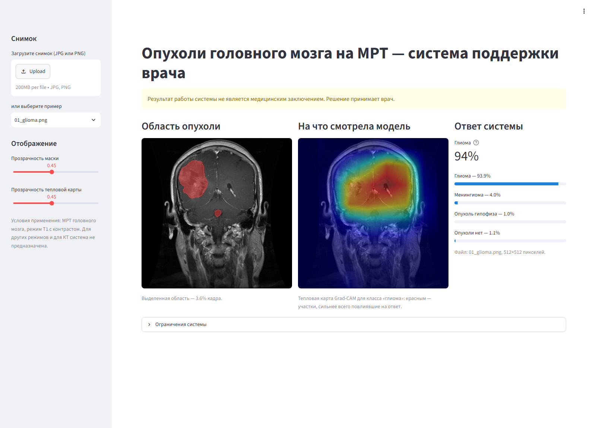

# ИИ-обнаружение и локализация опухолей головного мозга на МРТ

Система поддержки врача: по одному срезу МРТ головного мозга (режим T1 с контрастом) определяет, есть ли опухоль и какая (глиома, менингиома, опухоль гипофиза), обводит ее на снимке и ставит флаг «требует внимания врача», когда две модели системы расходятся. Это второе мнение, а не медицинское заключение.

## Как запустить

**Windows 10/11**

1. Скачайте проект: зеленая кнопка **Code → Download ZIP** вверху страницы. Распакуйте архив недалеко от корня диска — например, в «Загрузки» или в `C:\mri`: Windows не открывает файлы с путем длиннее 260 символов.
2. В распакованной папке дважды щелкните **`start_windows.bat`**.
3. Когда все будет готово, сам откроется браузер с прототипом. Выберите пример в панели слева или загрузите свой снимок (JPG или PNG).

Первый запуск занимает 5–10 минут и требует интернета: скрипт сам скачивает Python 3.10 и библиотеки. Следующие запуски — 20–30 секунд, интернет не нужен.

Если Windows покажет окно «Система Windows защитила ваш компьютер», нажмите «Подробнее» → «Выполнить в любом случае»: скрипт не подписан цифровой подписью. Чтобы остановить прототип, закройте черное окно.

**macOS (Apple Silicon) и Linux**

- macOS: дважды щелкните **`start_mac.command`**. Если macOS не дает его открыть, щелкните правой кнопкой → «Открыть». Можно и из Терминала: `bash start_mac_linux.sh`.
- Linux: `bash start_mac_linux.sh`.

Mac с процессором Intel не поддерживается: для него нет сборок PyTorch нужной версии. Запуск проверен на Windows 11. Скрипт для macOS и Linux устроен так же, но на этих системах не проверялся.

**Что ставится и куда.** В систему ничего не ставится: Python, библиотеки и кэш загрузок остаются внутри папки проекта (`.tools/` и `.venv-app/`). Уже установленный на компьютере Python не используется и не меняется. Чтобы удалить все, удалите папку. Видеокарта не нужна: снимок обрабатывается примерно за 0,6 секунды на обычном процессоре.

**Вручную** (если Python 3.10 уже установлен):

```bash
python -m venv .venv-app
.venv-app/Scripts/python -m pip install torch==2.14.1 torchvision==0.29.1 --index-url https://download.pytorch.org/whl/cpu
.venv-app/Scripts/python -m pip install -r requirements-app.txt
.venv-app/Scripts/python app/launch.py          # macOS и Linux: .venv-app/bin/python
```

Без интерфейса, из командной строки: `python -m src.inference снимок.jpg --out результат.png`.

## Что показывает прототип



- обведенную область опухоли поверх снимка (прозрачность настраивается);
- тепловую карту Grad-CAM: на какие участки снимка сильнее всего смотрел классификатор;
- ответ системы, уверенность и вероятности четырех классов;
- флаг «требует внимания врача» с причиной, если модели расходятся;
- напоминание, что это не медицинское заключение, и ограничения системы.

Восемь снимков-примеров в `app/examples/` взяты из проверочной части данных: на них модели не обучались. Все экраны — в [reports/prototype/screenshots/](reports/prototype/screenshots/).

## Результат на независимой тестовой выборке

Тестовая выборка — 582 снимка (533 с опухолью, 49 без) от пациентов, которых система не видела при обучении и выборе модели. Использовалась один раз. Подробно — [reports/metrics.md](reports/metrics.md).

| Мера | Результат |
| --- | --- |
| Найдено опухолей | 528 из 533 (99,1%; 95% ДИ 97,8–99,6) |
| Верно «опухоли нет» | 48 из 49 (98,0%; 95% ДИ 89,3–99,6) |
| Тип опухоли верен среди найденных | 443 из 528 (83,9%) |
| Точность обводки, Dice (по срезам / по пациентам) | 0,752 / 0,747 |
| Dice: менингиома / опухоль гипофиза / глиома | 0,878 / 0,845 / 0,632 |
| Время на снимок, обычный процессор без видеокарты | 0,64 с |

Разбор ошибок врачом команды — [docs/errors.md](docs/errors.md).

## Как устроено

```
снимок → подготовка (обрезка полей, 256×256, выравнивание яркости)
       → классификатор (ResNet34): тип опухоли и вероятность
       → сегментатор (U-Net, ResNet34): обводка опухоли
       → правило: «опухоль есть», если обведена область больше 50 пикселей
                   или классификатор уверен не меньше чем на 97,6%
       → флаг «требует внимания врача», если модели расходятся
```

Главное в работе — данные, а не архитектура:

- **Утечка в исходном делении.** У 72,9% тестовых снимков организаторов есть копия в обучающей части. Мы объединили все снимки, собрали копии и снимки одного пациента в группы и заново поделили по пациентам ([reports/leakage_report.md](reports/leakage_report.md), [reports/splits_report.md](reports/splits_report.md)).
- **Маски.** Обводок опухолей в данных кейса нет. Большая часть снимков совпала с открытым набором Figshare (Cheng et al.), где врачи обвели опухоли; сегментатор обучен на нем ([reports/figshare_match_report.md](reports/figshare_match_report.md)). Как размечать маски без готового набора — [docs/models.md](docs/models.md#если-бы-готовых-масок-не-нашлось), раздел «Если бы готовых масок не нашлось».
- **«Короткий путь».** Класс «опухоли нет» отличается от опухолей не только наличием опухоли, но и источником и режимом съемки: модель отличает его по одному размеру файла с AUC 0,98. Меры и проверки: единая подготовка снимков, рандомизация качества при обучении, стресс-тест, тест с закрашиванием опухоли, ручная проверка класса «нет опухоли» ([reports/shortcut_report.md](reports/shortcut_report.md), [reports/doctor_marks_report.md](reports/doctor_marks_report.md)).
- **Честная оценка.** Правила выбора моделей и порогов записывались до обучения; сравнения — на трех seed; тестовая выборка — один прогон; доверительные интервалы и метрики по подгруппам.

Подробнее: как мы готовили данные — [docs/data.md](docs/data.md); модели, проверенные варианты и рассмотренные подходы — [docs/models.md](docs/models.md); разбор ошибок — [docs/errors.md](docs/errors.md); внедрение, защита данных, регистрация и затраты — [docs/practical_use.md](docs/practical_use.md).

## Данные

Датасет, на котором обучены и проверены финальные модели, лежит в разделе [Releases](../../releases/latest) в двух видах:

| Архив | Что внутри | Зачем |
| --- | --- | --- |
| `brain_mri_dataset.zip`, 345 МБ | 3982 снимка в исходном виде, 3064 обводки опухолей, таблица `dataset.csv` (класс, часть train/val/test, источник, пациент) и описание | посмотреть данные, собрать кэш заново: `python -m src.import_dataset <папка>` |
| `brain_mri_cache256.zip`, 168 МБ | `data/processed/pool.csv` и кэш `pool_256` — снимки и маски 256×256 после подготовки | обучить модели сразу: распаковать в корень проекта |

Кэш, собранный из первого архива, побитово совпадает со вторым. Деление по пациентам: train 2875 / val 525 / test 582 снимка. Срезы Figshare распространяются по лицензии CC BY 4.0, при использовании указывайте авторов (см. «Источники»).

Таблицы отбора снимков лежат в репозитории, в `data/processed/`:

- `pool.csv` — итоговый набор: снимок, класс, часть, источник, группа пациента;
- `splits.csv` — судьба каждого из 12 064 файлов организаторов: в какой части, оригинал или копия, исключен ли и почему;
- `folds_frozen.csv` — замороженное деление групп пациентов на части;
- `review_decisions.csv` — решения по ручной проверке класса «нет опухоли» (оставлен или исключен и почему);
- `label_fixes.csv` — исправленные метки (по совпадению с Figshare).

## Как фильтровали исходный датасет

Нужны исходные данные организаторов в папке `mrt/` (в репозиторий не входят) и полное окружение: `pip install -r requirements.txt`, Python 3.10. Шаги по порядку:

```bash
python -m src.build_index            # опись 12 064 файлов: класс, часть, тип искажения по имени файла
python -m src.find_duplicates        # копии одного снимка по «отпечатку изображения»; утечка между частями
python -m src.download_figshare      # открытый набор Figshare с обводками опухолей
python -m src.convert_figshare       # .mat → PNG снимки и маски
python -m src.match_figshare         # совпадения со срезами Figshare: обводки и номера пациентов
python -m src.make_review_decisions  # правило отбора класса «нет опухоли» по ответам проверяющих
python -m src.make_splits            # деление по пациентам (по folds_frozen.csv) и все исключения
python -m src.build_cache            # подготовка снимков организаторов (для оценки на JPEG-версиях)
python -m src.build_pool             # итоговый набор pool.csv и кэш pool_256
```

Исправления меток (`label_fixes.csv`) уже в репозитории. Их собирает `python -m src.make_label_fixes` из ответов по спорным случаям, а эти ответы в репозиторий не входят. Ответы проверяющих по классу «нет опухоли» — `reports/doctor/no_tumor_review/`. Что найдено и как исправлено — [docs/data.md](docs/data.md); отчеты отдельных проверок — в `reports/`: `index_report.md`, `leakage_report.md`, `figshare_match_report.md`, `splits_report.md`, `shortcut_report.md`, `pool_report.md`.

## Обучение и оценка

Финальные модели — классификатор `configs/run1_cls.yaml` и сегментатор `configs/run1_seg_neg.yaml`, оба на seed 42. Их веса лежат в `models/final/`.

```bash
pip install -r requirements.txt                                    # Python 3.10
# данные: распаковать brain_mri_cache256.zip в корень проекта
#         (или python -m src.import_dataset ../brain_mri_dataset)
python -m src.train --config configs/run1_cls.yaml --seed 42       # классификатор
python -m src.train --config configs/run1_seg_neg.yaml --seed 42   # сегментатор
python -m src.presence               # порог решения «опухоль есть» по val → configs/presence.yaml
python -m src.freeze                 # финальные веса и порог → models/final/
python -m src.evaluate --split test  # итоговая оценка → reports/eval_test/
```

На видеокарте Tesla T4 (бесплатный Kaggle) классификатор учится около 3,5 минуты, сегментатор — около 14. На обычном процессоре это часы. Как запускать обучение в Kaggle — [docs/kaggle.md](docs/kaggle.md). Оценка по архиву датасета, без исходных данных организаторов: `python -m src.evaluate --split test --data-root <папка датасета> --fig-root <папка датасета> --no-extra`.

Все запуски обучения с параметрами и метриками — [reports/experiments.csv](reports/experiments.csv).

## Ограничения

- Условия применения — МРТ головного мозга, T1 с контрастом, 2D-срез. Входного контроля режима пока нет.
- Здоровых снимков в режиме T1 с контрастом в данных почти нет (10–12), поэтому specificity на таких снимках не проверена; класс «нет опухоли» — снимки других режимов и источников.
- Классификатор отвечает «опухоль есть» во многом по виду снимка, а не по самой опухоли (тест с закрашиванием); решение системы поэтому опирается и на сегментатор.
- Тип опухоли на новых пациентах верен примерно в 84% случаев, ошибки собраны у нескольких пациентов.
- Нужна проверка на данных клиники.

## Структура

```
start_windows.bat, start_mac.command, start_mac_linux.sh   запуск прототипа
app/        прототип на Streamlit (app/app.py), запуск — app/launch.py, примеры — app/examples/
models/final/  финальные веса и порог решения
src/        код: подготовка данных, обучение, оценка, инференс (src/inference.py)
configs/    конфиги запусков; configs/presence.yaml — порог решения «опухоль есть»
data/processed/  таблицы отбора и деления снимков
reports/    отчеты проверок, графики, итоговая оценка (reports/metrics.md), experiments.csv
docs/       данные, модели, разбор ошибок, внедрение, инструкция по Kaggle
notebooks/  ноутбук-запускатель обучения в Kaggle
```

## Источники

- Датасет кейса — организаторы чемпионата.
- Cheng J. et al. Brain tumor dataset. Figshare, version 8. [doi:10.6084/m9.figshare.1512427](https://doi.org/10.6084/m9.figshare.1512427). Лицензия CC BY 4.0.
- Предобученные веса ImageNet: `timm/resnet34.a1_in1k` (библиотека timm).
- Библиотеки: PyTorch, timm, segmentation-models-pytorch, albumentations, OpenCV, scikit-learn, pandas, pytorch-grad-cam, Streamlit — версии в [requirements.txt](requirements.txt).
- При разработке кода и документации использовался ИИ-ассистент Claude (Anthropic).
