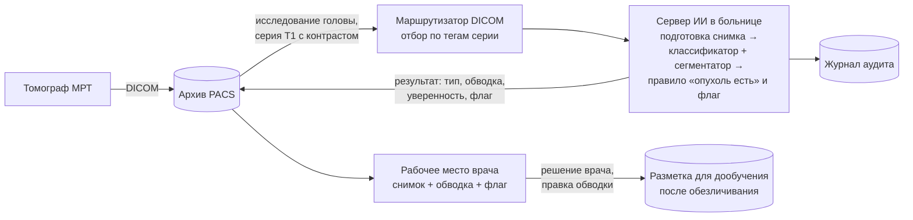

# Практическое применение

Система ставится на сервер внутри больницы, получает снимки из архива PACS, а ответ — тип опухоли, обводку и флаг для врача — возвращает на рабочее место врача. Видеокарта не нужна: снимок обрабатывается за 0,6 с на обычном процессоре. До клинического применения систему нужно зарегистрировать как медицинское изделие; до регистрации — только исследовательский режим.

Допущения: конкретного заказчика нет, описываем типовое внедрение в больнице; система работает на сервере в больнице; экономику считаем только по затратам.

## 1. Схема внедрения

Как это работает:

1. Томограф отправляет исследование в архив PACS, как и сейчас.
2. Маршрутизатор DICOM отбирает только подходящие серии: МРТ головного мозга, T1 с контрастом. Остальное в систему не попадает — это входной контроль режима.
3. Сервер ИИ обрабатывает каждый срез серии: две модели и правило «опухоль есть», как в прототипе (`src/inference.py`).
4. Результат возвращается в PACS отдельной серией (снимок с обводкой и текстом) и виден врачу в привычной программе просмотра.
5. Врач принимает решение сам. Флаг «требует внимания врача» подсказывает, где две модели не согласились.
6. Каждое обращение пишется в журнал аудита. Правки обводок врачом после обезличивания можно использовать для дообучения на данных этой больницы (см. «Если бы готовых масок не нашлось» в `docs/models.md`).

## 2. Требования к ресурсам

Замер на ноутбуке (AMD Ryzen 5 5600H, 6 потоков вычислений, без видеокарты), замороженная система `models/final/`, 8 снимков-примеров, по 3 прохода:

| Показатель | Значение |
| --- | --- |
| Время на снимок с тепловой картой | 0,64 с (медиана), до 1,10 с |
| Время на снимок без тепловой карты | 0,31 с (медиана), до 0,46 с |
| Загрузка моделей при старте | 1,8 с |
| Память процесса | 0,60 ГБ после загрузки, до 0,76 ГБ при обработке |
| Размер весов | 81 МБ (классификатор) + 93 МБ (сегментатор) |
| Пропускная способность одного процесса | около 5 600 снимков в час |

Если в серии 20–30 срезов (допущение, зависит от протокола), исследование обрабатывается за 15–20 секунд — быстрее, чем врач открывает его на просмотр.

Минимальный сервер: 4–8 ядер, 8–16 ГБ оперативной памяти, 50 ГБ диска под систему, журналы и временные файлы. Видеокарта не требуется. Замер на видеокарте не делался: локально ее нет, а для внедрения она не нужна.

## 3. Защита данных

Снимки и результаты — сведения о здоровье, то есть специальная категория персональных данных (152-ФЗ, ст. 10) и врачебная тайна (323-ФЗ, ст. 13).

- **Данные не покидают больницу.** Обработка идет на ее сервере, внешние сервисы не нужны. Это главная мера и причина выбора размещения.
- **Информационная система персональных данных.** Сервер ИИ становится частью ИСПДн больницы; уровень защищенности определяется по требованиям ПП РФ от 01.11.2012 № 1119.
- **Технические меры:** шифрование при передаче внутри сети (TLS), шифрование дисков сервера, ролевой доступ (врач, администратор, разработчик без доступа к данным пациентов), журнал аудита каждого обращения.
- **Обезличивание** — только когда данные выходят за пределы больницы: для дообучения и внешней проверки. Удаляются идентифицирующие теги DICOM (имя, дата рождения, номер исследования и т. п.), снимок отделяется от личности пациента. Требования и методы обезличивания — по приказу Роскомнадзора от 19.06.2025 № 140.
- **Этика.** Кодекс этики применения ИИ в сфере охраны здоровья: окончательное решение — за врачом, врач видит, что подсказка сделана ИИ, и понимает ее ограничения. В интерфейсе это уже есть: дисклеймер «не является медицинским заключением» и блок «Ограничения системы».

## 4. Регуляторика: путь регистрации

ПО для диагностики, в том числе с ИИ, — медицинское изделие (323-ФЗ, ст. 38), и для клинического применения его нужно зарегистрировать в Росздравнадзоре. Регистрация идет по Правилам, утвержденным ПП РФ от 30.11.2024 № 1684: в силе с 1 марта 2025 г., действуют до 31 декабря 2026 г., дальше планируется переход к регулированию ЕАЭС. Документы подаются только в электронном виде; для ПО и ПО с ИИ в Правилах есть отдельные положения.

| Этап | Что делаем | Опора |
| --- | --- | --- |
| 0. Класс риска | Определить класс потенциального риска. Для ПО с ИИ на практике чаще всего класс 3 — самый строгий; встречаются и регистрации в классах 2а–2б | практика рынка; точные критерии сверить по действующему приказу Минздрава о классификации |
| 1. Документация | Техническая и эксплуатационная документация; для ИИ — описание наборов данных, обучения, метрик, ограничений | ГОСТ Р 59921.5-2022 (требования к наборам данных) |
| 2. Технические испытания | Проверка на независимом наборе снимков в испытательной лаборатории | ГОСТ Р 59921.2-2021, ГОСТ Р 59921.7-2022 (алгоритмы анализа изображений) |
| 3. Клинические испытания | Проверка в медицинской организации на ее снимках; метрики клинической валидации | ГОСТ Р 59921.1-2022 (клиническая оценка) |
| 4. Экспертиза и регистрация | Экспертиза качества, эффективности и безопасности; регистрационное удостоверение | ПП № 1684; госпошлина — НК РФ ст. 333.32.2 |
| 5. После регистрации | Мониторинг: автоматическая передача данных о работе ПО с ИИ, включая ошибки, в систему Росздравнадзора; изменения версий — по особым правилам для ПО с ИИ | приказы Росздравнадзора от 21.07.2025 № 4472 и от 10.02.2026 № 123; ГОСТ Р 59921.6-2021 |

До регистрации систему можно применять только в исследовательском режиме: пилот в больнице как часть клинических испытаний, без влияния на лечение. Ориентиры по стоимости и срокам — в разделе 5; точные цифры дают испытательные центры по запросу.

Что из нашей работы пригодится для регистрации уже сейчас: описание данных и их чистки (`docs/data.md`), записанные до обучения правила оценки (`docs/models.md`), отчет на независимом тесте с интервалами (`reports/metrics.md`), разбор ошибок с врачом (`docs/errors.md`), список ограничений.

## 5. Затраты

Только затраты, без выгоды. Цены — по открытым прайсам продавцов и испытательных центров (октябрь 2026 г.); где открытой цены нет, затраты посчитаны по трудозатратам и помечены как наша оценка. Перед закупкой их нужно уточнить по 2–3 коммерческим предложениям.

**На одну больницу**

| Статья | Что входит | Оценка | Основа |
| --- | --- | --- | --- |
| Сервер | 4–8 ядер, 16 ГБ памяти, SSD, без видеокарты; или виртуальная машина на имеющемся сервере больницы | 0,15–0,25 млн ₽ (ВМ — 0) | сервер Dell PowerEdge T150 на Xeon E-2300 — от 140–157 тыс. ₽ в каталогах |
| Интеграция с PACS | маршрутизатор DICOM (Orthanc — бесплатно), прием серий, возврат результата, отбор по тегам | 0,3–0,6 млн ₽ | наша оценка: 1–2 месяца инженера (зарплата 225 тыс. ₽ в месяц плюс взносы) |
| Защита информации | средство защиты от НСД на сервер, шифрование, журнал аудита, доработка модели угроз и документов ИСПДн | 0,2–0,35 млн ₽ | лицензии Dallas Lock 8.0-С — от 20 тыс. ₽, Secret Net Studio — от 13 тыс. ₽; работы — наша оценка (0,5–1 месяц специалиста) |
| Сопровождение | мониторинг, передача данных в Росздравнадзор, обновления, обучение врачей | 0,4–0,9 млн ₽ в год | наша оценка: 0,1–0,25 ставки инженера |

Итого на больницу — около 0,65–1,2 млн ₽ на запуск и 0,4–0,9 млн ₽ в год.

**Один раз для разработчика** (делится на все больницы)

| Статья | Что входит | Оценка | Основа |
| --- | --- | --- | --- |
| Госпошлины | экспертиза качества, эффективности и безопасности (класс 3) и регистрационное удостоверение | 0,195 млн ₽ | НК РФ ст. 333.32.2: 184 000 + 11 000 ₽ |
| Технические испытания | испытания в аккредитованной лаборатории | от 0,2–0,25 млн ₽ | прайсы «Медалис», «Экосейфти» |
| Клинические испытания | по данным (ретроспективно) — от 0,35 млн ₽; с участием пациентов — от 2,5 млн ₽ | 0,35–2,5 млн ₽ | прайс «Медрелик» |
| Документация и сопровождение регистрации | досье, программы испытаний, ответы на запросы экспертизы | от 0,5 млн ₽ | прайс «Медрелик» (национальная процедура, 8–12 месяцев) |

Итого регистрация — около 1,3–3,5 млн ₽ и 8–12 месяцев. Внешняя проверка на снимках больницы (разметка врачом с помощником, см. `docs/models.md`) входит в клинические испытания.

## 6. Что не готово для внедрения

- Прием DICOM и отбор серий по тегам — в прототипе только JPG/PNG.
- Входной контроль режима МРТ: на снимках не T1 с контрастом система не проверена и должна от них отказываться.
- Проверка на данных клиники: на здоровых снимках T1 с контрастом система не проверялась вовсе.
- Тип опухоли на новых пациентах верен примерно в 84% случаев; уверенность в середине шкалы завышена.

## Источники

- ПП РФ от 30.11.2024 № 1684 «Об утверждении Правил государственной регистрации медицинских изделий»: [Гарант](https://www.garant.ru/products/ipo/prime/doc/410924190/), разбор — [Право.ру](https://pravo.ru/story/260947/).
- Приказ Росздравнадзора от 21.07.2025 № 4472 о передаче данных о работе ПО с ИИ: [Фармвестник](https://pharmvestnik.ru/documents/4472-ot-21-07-2025.html), [новость](https://pharmvestnik.ru/content/news/Dannye-ob-oshibkah-PO-medizdelii-s-II-budut-peredany-v-sistemu-Roszdravnadzora.html); приказ от 10.02.2026 № 123 — [ppt.ru](https://ppt.ru/obzory/vstupaet-v-silu/prikaz-roszdravnadzora-10-02-2026-123).
- Комплекс ГОСТ Р 59921 «Системы искусственного интеллекта в клинической медицине»: [ГОСТ Р 59921.0-2022](https://www.gostinfo.ru/catalog/Details/?id=7069155), [ГОСТ Р 59921.7-2022](https://www.gostinfo.ru/catalog/Details/?id=7069168), [ГОСТ Р 59921.1-2022](https://prg.kz/m/amp/document/34701004), [ГОСТ Р 59921.6-2021](https://prg.kz/m/amp/document/39791441); рекомендации ВНИИИМТ — [ЧГМА](https://chitgma.ru/nauka/novosti-nauchnoj-raboty/o-provedenii-klinicheskih-ispytanij-programmnogo-obespechenija-s-iskusstvennym-intellektom/16086/).
- Класс риска ПО с ИИ на практике: [ComNews о «Цельс»](https://www.comnews.ru/content/214882/2021-06-07/2021-w23/cels-pervyy-ii-servis-poluchivshiy-registracionnoe-udostoverenie-medizdeliya-3-klassa).
- Госпошлина за регистрацию медизделий — НК РФ ст. 333.32.2: экспертиза класса 3 — 184 000 ₽, удостоверение — 11 000 ₽ ([КонсультантПлюс](https://www.consultant.ru/document/cons_doc_LAW_28165/3005a0b811c47e94f3072b62fc0e73beb6d566dd/)); есть проект исключить пошлины с 2027 г. ([Фармвестник](https://pharmvestnik.ru/content/news/Minzdrav-nameren-iskluchit-poshliny-na-registraciu-medizdelii-iz-nalogovogo-kodeksa.html)).
- Испытания и сопровождение регистрации: [Медалис](https://www.medalis.ru/price), [Медрелик](https://medrelic.ru/ceny/), [Экосейфти](https://reg.ecosafety.ru/tpost/knumehme21-tsenoobrazovanie-registratsii-mi).
- Сервер: [Servermall](https://servermall.ru/sets/tower-servery/), [ITtelo](https://www.ittelo.ru/server/filter/tower/); средства защиты: [Astral — Dallas Lock](https://is.astral.ru/product/sredstva-zashchity-ot-nesanktsionirovannogo-dostupa-nsd/server-bezopasnosti-dallas-lock-8-0-%D1%81/), [Astral — Secret Net Studio](https://is.astral.ru/product/sredstva-zashchity-ot-nesanktsionirovannogo-dostupa-nsd/secret-net-studio/); зарплата DevOps-инженера (Хабр Карьера, 2024): [Хабр](https://habr.com/ru/articles/846820).
- 152-ФЗ, 323-ФЗ, ПП РФ № 1119, приказ Роскомнадзора № 140, Кодекс этики применения ИИ в сфере охраны здоровья — список актов от организаторов чемпионата.
