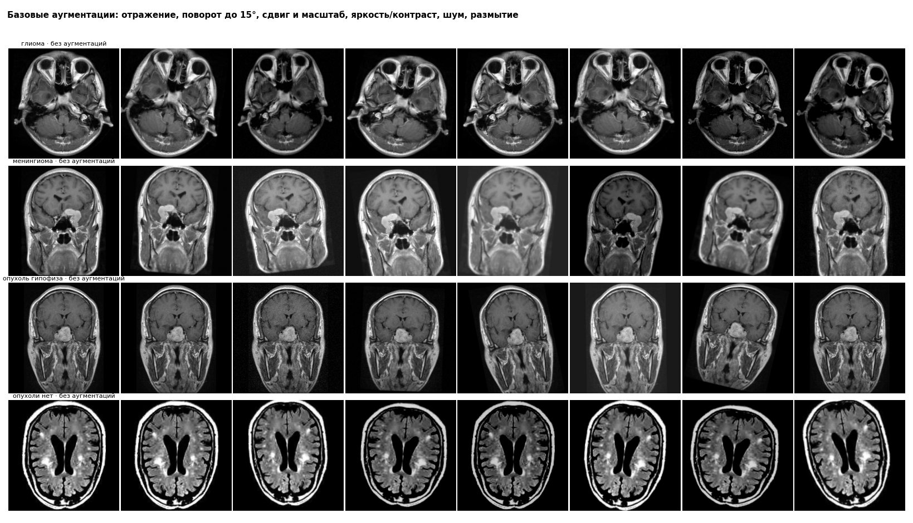
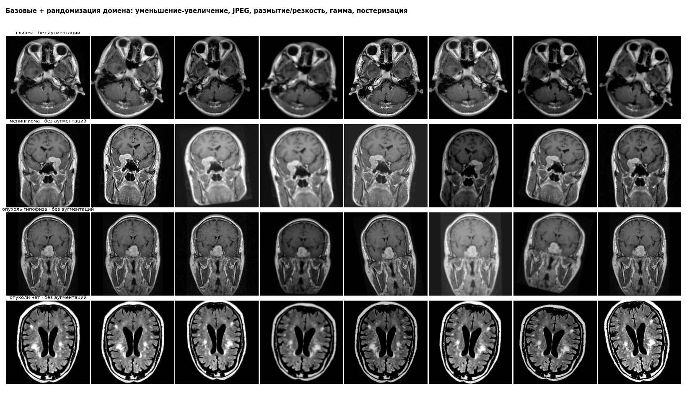
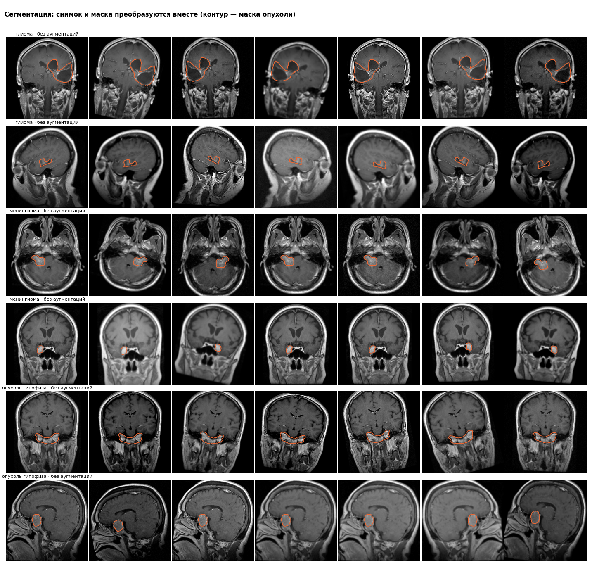

# Dataset и DataLoader

`src/dataset.py`, настройки — `configs/base.yaml`. Источник — `splits.csv`, только рабочие снимки (primary): train 2658, val 496. Test в проверках не участвует.

## Тензоры

- батч train: image (32, 3, 256, 256) torch.float32, диапазон -2.12…2.64; label (32,) torch.int64
- батч val (без аугментаций): image (32, 3, 256, 256), среднее -0.903, СКО 1.022
- эпоха train: 2656 из 2658 снимков (batch_size 32, неполный последний батч отбрасывается)

## Классы и веса

| index | снимков в train | в эпохе (drop_last) | вес класса |
|---|---|---|---|
| глиома | 976 | 975 | 0.681 |
| менингиома | 635 | 634 | 1.046 |
| опухоль гипофиза | 711 | 711 | 0.935 |
| опухоли нет | 336 | 336 | 1.978 |

Вес класса = N / (K · n_c): чем меньше снимков, тем больше вес в функции потерь.

## Воспроизводимость

| проверка | результат |
|---|---|
| тот же seed, 0 процессов: два запуска совпали | да |
| тот же seed, 2 процесса: два запуска совпали | да |
| вторая эпоха отличается от первой (0 процессов) | да |
| вторая эпоха отличается от первой (2 процесса) | да |
| другой seed дает другие батчи | да |

## Скорость (CPU, один процесс, с аугментациями)

- с кэшем препроцессинга: 2.0 мс на снимок; полная эпоха train — 6 с (482 снимков/с)
- без кэша (чтение файла + препроцессинг на лету): 28.5 мс на снимок — в 14.3 раза медленнее
- кэш: 3689 снимков, 231 МБ

## Аугментации

## Маски (сегментация, 18 снимков Figshare, не связанных с test)

- отражение по горизонтали: снимок и маска отражаются одинаково — да
- чтение через кэш с масками совпадает с расчетом на лету — да
- после полных аугментаций маска остается бинарной — да; площадь маски относительно исходной: минимум 0.87, медиана 1.00, максимум 1.14

## Рандомизация домена против технических признаков (train)

AUC «опухоль / нет опухоли» по техническим признакам готового снимка 256×256 (0,5 — признак бесполезен). Чем ближе к 0,5 после аугментаций, тем труднее сети опереться на этот признак.

| index | без аугментаций | базовые | базовые + рандомизация домена |
|---|---|---|---|
| контраст (СКО яркости) | 0.725 | 0.696 | 0.689 |
| доля пересвеченных пикселей | 0.745 | 0.621 | 0.61 |
| резкость (лапласиан) | 0.628 | 0.61 | 0.578 |
| средняя яркость | 0.578 | 0.579 | 0.587 |
| число уровней серого | 0.51 | 0.509 | 0.519 |
| все признаки вместе (3 фолда по пациентам) | 0.9 | 0.792 | 0.693 |
