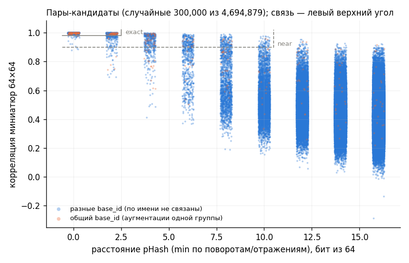
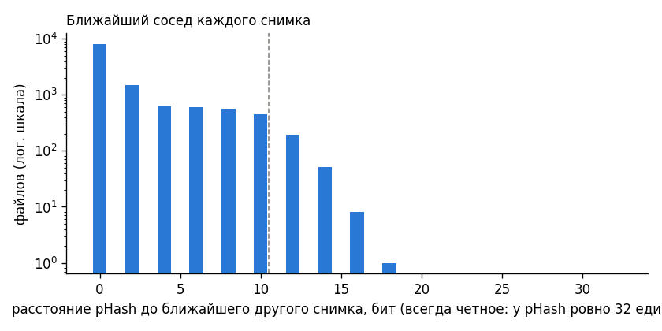

# Утечка и дубликаты

Уровни связи двух снимков:
- **exact** — тот же снимок: md5 совпадает или pHash ≤ 2 и корреляция ≥ 0.98 (пересохранение, отражение, поворот на 90°, яркость);
- **near** — exact или (оба файла — оригиналы, pHash ≤ 10 и корреляция ≥ 0.9): тот же снимок с сильной обработкой или соседний срез того же пациента. Аугментированные копии в near-связях не участвуют (у BR/DA/SP корреляция завышается), в группы они попадают через base_id.

- файлов: 12064; пар-кандидатов (pHash ≤ 16): 4,694,879
- пар exact: 16,000; пар near (включая exact): 26,650
- точных копий по md5: 2198 файлов в 1026 группах
- файлов с хотя бы одной копией: exact 9309, near 9631

## Пары по типу

| уровень | splits | РАЗНЫЕ классы | один класс |
|---|---|---|---|
| exact | test↔test | 0 | 946 |
| exact | train↔test | 5 | 5276 |
| exact | train↔train | 17 | 9756 |
| near (не exact) | test↔test | 0 | 809 |
| near (не exact) | train↔test | 2 | 4140 |
| near (не exact) | train↔train | 2 | 5697 |

## Утечка train → test

### Уровень exact: прямая связь test ↔ train

Test-файлов с копией в train: **1761 из 2414 (72.9%)**, из них оригиналов: 1648. Train-файлов с копией в test: 3057.

| cls | нет копии | есть копия в train |
|---|---|---|
| glioma | 275 | 480 |
| meningioma | 282 | 264 |
| no_tumor | 57 | 430 |
| pituitary | 39 | 587 |

### Уровень near: прямая связь test ↔ train

Test-файлов с копией в train: **1820 из 2414 (75.4%)**, из них оригиналов: 1707. Train-файлов с копией в test: 3485.

| cls | нет копии | есть копия в train |
|---|---|---|
| glioma | 270 | 485 |
| meningioma | 280 | 266 |
| no_tumor | 20 | 467 |
| pituitary | 24 | 602 |

## Группы уровня exact (base_id ∪ связи exact) — `group_exact_id`

- всего групп: 3696; одиночных: 1265; максимальный размер: 57
- групп и в train, и в test: **1253**
- групп с разными классами: **6**

## Группы уровня near (base_id ∪ связи near) — `group_id`

- всего групп: 3069; одиночных: 950; максимальный размер: 81
- групп и в train, и в test: **1107**
- групп с разными классами: **6**

## Конфликт меток: прямые пары снимков из разных классов — 26

Сетки для врача: `leakage/label_conflicts_exact.png`, `leakage/label_conflicts_near.png`; список — `data/processed/label_conflict_pairs.csv`.

| классы | exact | near |
|---|---|---|
| glioma + meningioma | 3 | 4 |
| meningioma + pituitary | 19 | 0 |

## Группы aug_GMPN без оригинала в своем split

| split без оригинала | оригинал в другом split | групп |
|---|---|---|
| train | False | 10 |
| test | False | 6 |
| train | True | 3 |

## Файлы `image(N) - Copy`

Совпадают по md5 с оригиналом `image(N)`: 22 из 22.
