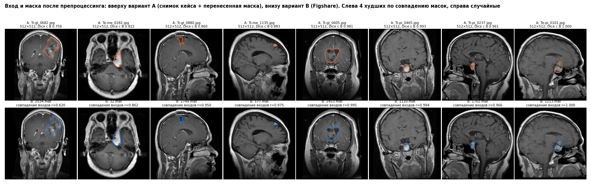

# Источник масок для сегментации

Три варианта. Test в расчетах не участвует (сравнение А и В — на снимках train и val).

- **А** — снимки кейса + маски, перенесенные из Figshare (только exact-совпадения);
- **Б** — Figshare с собственным делением по пациентам (как в исходном плане);
- **В** — Figshare в исходном виде (PNG без сжатия + исходная маска), а часть train/val/test наследуется от сплита кейса по пациенту (`pid_base`).

## Объем по частям

Вариант А — рабочие снимки кейса с маской:

| index | train | val | test | всего |
|---|---|---|---|---|
| глиома | 853 | 168 | 178 | 1199 |
| менингиома | 478 | 72 | 89 | 639 |
| опухоль гипофиза | 591 | 107 | 120 | 818 |
| всего | 1922 | 347 | 387 | 2656 |

Рабочих снимков опухолей без маски (их нет в Figshare): 567 из 3223 — в обучении сегментатора не участвуют ни в одном варианте.

Вариант В — срезы Figshare:

| index | train | val | test | всего |
|---|---|---|---|---|
| глиома | 1023 | 193 | 210 | 1426 |
| менингиома | 534 | 75 | 99 | 708 |
| опухоль гипофиза | 672 | 123 | 135 | 930 |
| всего | 2229 | 391 | 444 | 3064 |

Вариант В — пациенты:

| index | train | val | test | всего |
|---|---|---|---|---|
| глиома | 50 | 7 | 8 | 65 |
| менингиома | 63 | 8 | 11 | 82 |
| опухоль гипофиза | 44 | 10 | 8 | 62 |
| всего | 157 | 25 | 27 | 209 |

- срезов Figshare, которых нет в кейсе: 417 (train 312, val 45, test 60) — вариант В добавляет их к обучению и оценке
- пациентов Figshare, которых нет в кейсе: 3 (10 срезов) — отнесены в train

## Вариант Б дает утечку относительно сплита кейса

Собственное деление Figshare (тот же метод, seed 42) против сплита кейса, срезы:

| index | в сплите кейса: train | в сплите кейса: val | в сплите кейса: test |
|---|---|---|---|
| часть в варианте Б: train | 1424 | 364 | 357 |
| часть в варианте Б: val | 520 | 14 | 28 |
| часть в варианте Б: test | 275 | 13 | 59 |

- 357 срезов попали бы в обучение сегментатора, хотя их пациенты — в test кейса;
- 275 срезов попали бы в тест сегментатора, хотя их пациенты — в train кейса.
Итоговая система оценивается на test кейса, поэтому вариант Б непригоден.

## А против В: одно и то же? (800 случайных пар из train и val)

Для снимка кейса и его двойника из Figshare после препроцессинга сравниваются входы (корреляция) и маски (Dice).

| index | пар | совпадение_входов_медиана | совпадение_входов_5й_перцентиль | dice_масок_медиана | dice_масок_5й_перцентиль | доля_dice_от_0_9 |
|---|---|---|---|---|---|---|
| глиома | 345 | 0.996 | 0.954 | 0.987 | 0.946 | 0.994 |
| менингиома | 186 | 0.999 | 0.962 | 0.987 | 0.952 | 0.978 |
| опухоль гипофиза | 269 | 1.0 | 0.957 | 1.0 | 0.94 | 1.0 |

- Dice масок ниже 0,9: 6 из 800; ниже 0,8: 1
- снимков кейса не 512×512 в выборке: 3; у них Dice масок — медиана 1.000, совпадение входов 0.998

## Снимки без опухоли для сегментатора

В Figshare опухоль есть на каждом срезе. Снимки без опухоли есть только в кейсе: train 336, val 71, test 59 (до чистки по разметке врача). Они могут идти в сегментацию с пустой маской, но взяты из других источников — сегментатор может выучить «чужой источник → пустая маска» (тот же shortcut).

## Предложение

**Вариант В.** Обучать сегментатор на Figshare в исходном виде, часть train/val/test наследовать от сплита кейса по пациенту.

- данных больше: train 2229 срезов против 1922 в варианте А;
- маски точные: это исходная разметка для своего снимка, без переноса (в варианте А у 6 из 800 проверенных пар маска после переноса расходится с исходной, Dice ниже 0,9);
- входы те же: после препроцессинга снимок кейса и его двойник из Figshare совпадают (корреляция по медиане 1.000); сжатие JPEG, которого нет в PNG, добавляется аугментацией;
- утечки нет: пациент целиком в одной части, той же, что в сплите кейса.

Оценка сегментации: основная — на срезах Figshare пациентов из test; дополнительная — на снимках кейса из test (те же срезы после JPEG), чтобы показать работу на файлах в том виде, в каком они приходят.

Рабочие снимки опухолей без маски (567 шт., не из Figshare) — проверка обобщения: сегментатор, обученный на Figshare, должен находить на них область опухоли (доля снимков с маской больше порога).

Снимки без опухоли: обучить сегментатор в двух вариантах — без них и с ними (пустая маска) — и сравнить по ложным маскам на снимках «нет опухоли» из val и по стресс-тесту.
