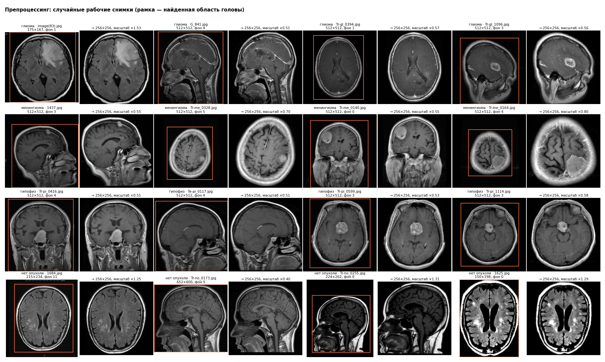
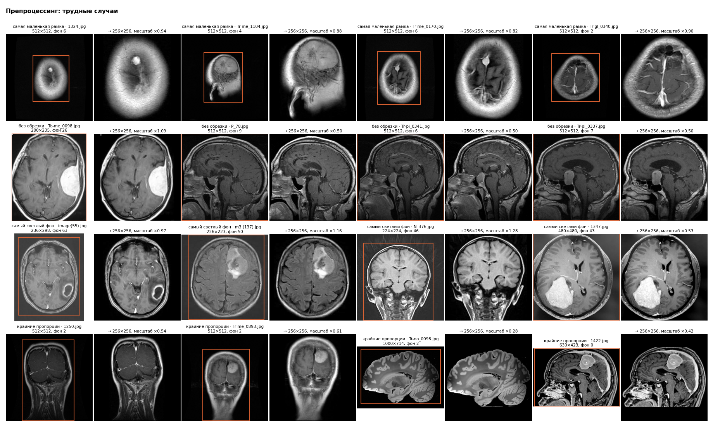
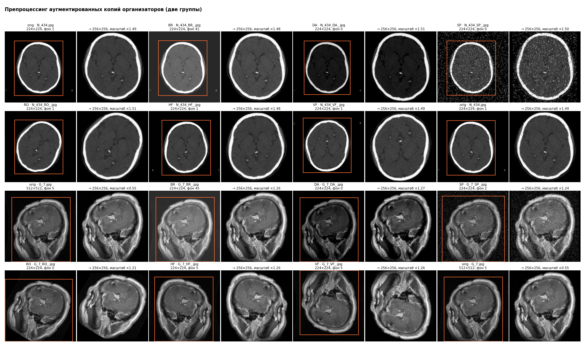
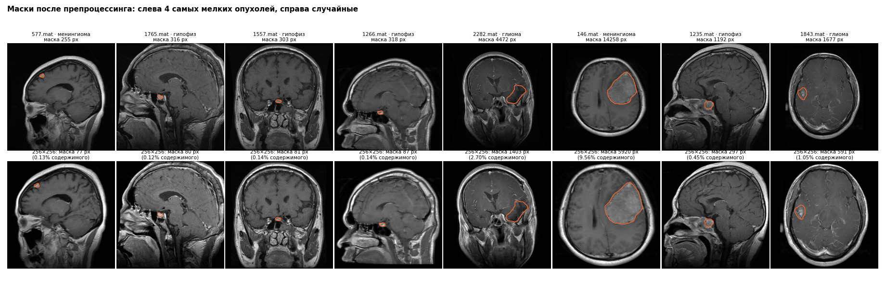

# Препроцессинг

`src/preprocess.py`: серый → срезание однородных полей и рамок-линий → рамка головы относительно уровня фона → нормализация яркости (фон → 0, 99,5-й перцентиль тканей → 1) → 256×256 с сохранением пропорций → uint8. Test в проверках не участвует.

## Обрезка и приведение размера (рабочие снимки train и val, 3154)

| index | снимков | рамка_доля_кадра_медиана | без_обрезки | масштаб_медиана | поля_после_приведения_медиана | яркость_результата_медиана | уровней_серого_медиана |
|---|---|---|---|---|---|---|---|
| глиома | 1165 | 0.649 | 4 | 0.57 | 0.129 | 66.921 | 256.0 |
| менингиома | 740 | 0.692 | 15 | 0.569 | 0.113 | 72.421 | 256.0 |
| гипофиз | 842 | 0.844 | 74 | 0.511 | 0.09 | 71.457 | 256.0 |
| нет опухоли | 407 | 0.765 | 23 | 1.085 | 0.156 | 75.715 | 256.0 |

- без обрезки (рамка = весь кадр): 116; рамка касается ≥ 3 краев кадра: 266
- рамка меньше 25% кадра: 1; минимум 0.220
- время препроцессинга на CPU (без чтения файла): медиана 32.1 мс, 95-й перцентиль 45.6 мс

## Устойчивость к аугментациям организаторов (100 полных групп из train)

Рамка копии сравнивается с рамкой оригинала (в долях кадра), результат копии — с результатом оригинала. Для HF и VF оригинал предварительно отражается; для RO рамка не сравнивается (снимок повернут).

| aug | групп | рамка_IoU_медиана | рамка_IoU_5й_перцентиль | доля_IoU_от_0_9 | corr_результата_медиана | corr_5й_перцентиль |
|---|---|---|---|---|---|---|
| BR | 100 | 0.995 | 0.982 | 1.0 | 0.985 | 0.723 |
| DA | 100 | 0.985 | 0.834 | 0.88 | 0.9 | 0.422 |
| SP | 100 | 0.956 | 0.865 | 0.84 | 0.832 | 0.534 |
| HF | 100 | 0.995 | 0.983 | 1.0 | 0.982 | 0.724 |
| VF | 100 | 0.995 | 0.983 | 1.0 | 0.985 | 0.723 |
| RO | 100 | nan | nan | nan | 0.433 | 0.274 |

## Маски (Figshare, не связанные с test: 2662 снимков)

| index | масок | срезано_обрезкой_макс | площадь_до_медиана_проц | площадь_после_медиана_проц | пикселей_после_медиана | пикселей_после_минимум | dice_туда_обратно_медиана | dice_5й_перцентиль |
|---|---|---|---|---|---|---|---|---|
| глиома | 1242 | 0.0 | 1.81 | 2.871 | 1633.5 | 93 | 0.99 | 0.977 |
| менингиома | 616 | 0.0 | 1.445 | 2.16 | 1230.0 | 77 | 0.99 | 0.976 |
| гипофиз | 804 | 0.0 | 0.67 | 0.789 | 467.5 | 80 | 0.983 | 0.966 |

- масок, задетых обрезкой: 0 (потеряно более 1% площади: 0)
- масок меньше 50 пикселей после препроцессинга: 0; меньше 100: 12
- Dice «в модель и обратно» ниже 0,9: 0

