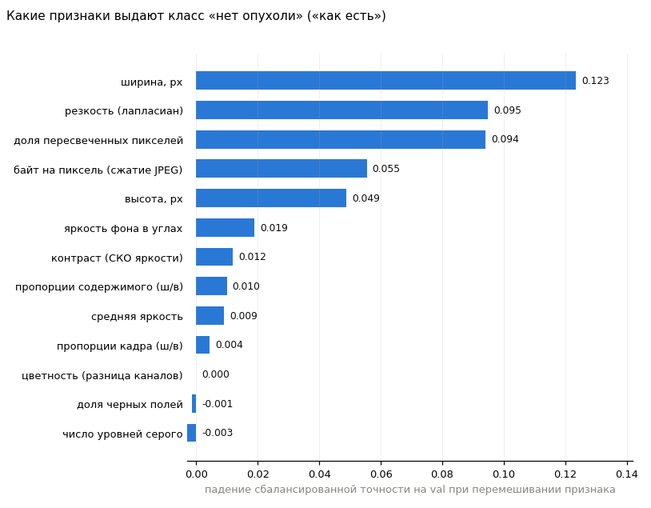
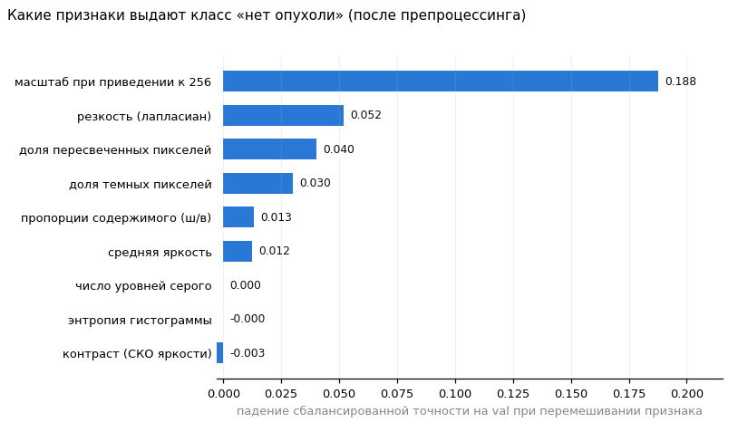
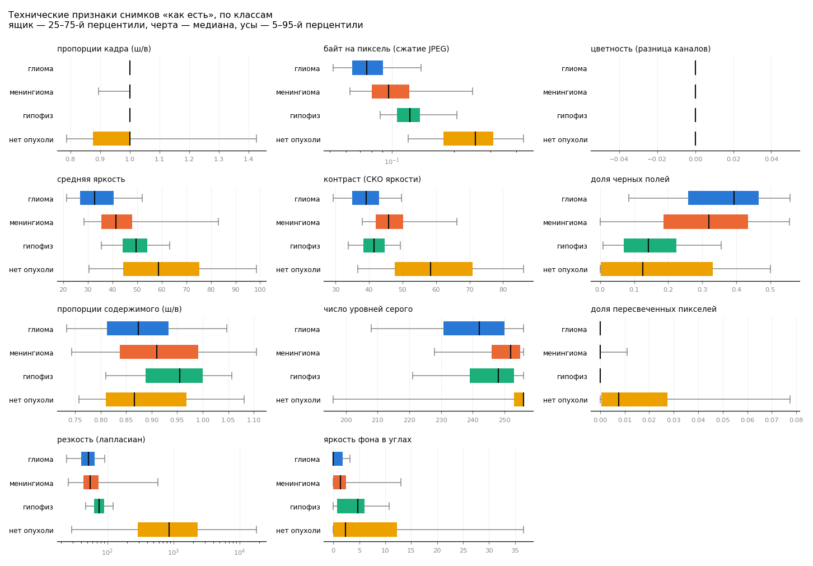
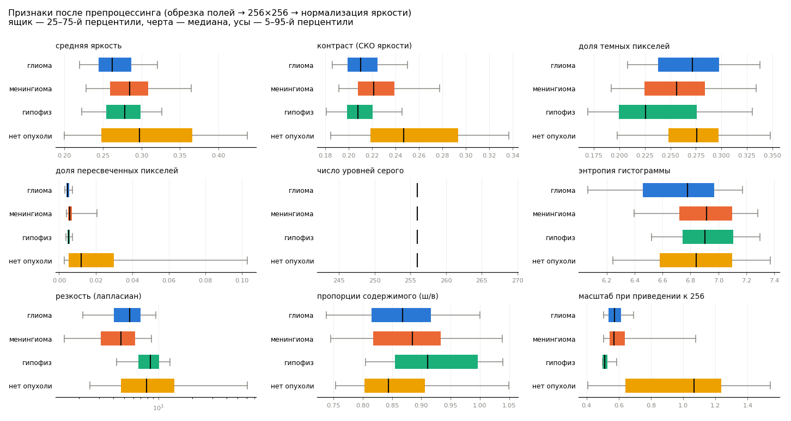

# Проверка shortcut

Рабочие снимки: 3689 (train 2568, val 481, test 525). Проба обучается на train и оценивается на val; test не используется.

## Проба: угадывается ли класс без пикселей

Градиентный бустинг только на технических признаках. Если класс угадывается — нейросеть тоже может выучить эти признаки вместо опухоли. Случайное угадывание: AUC 0,5; сбалансированная точность 4 классов 0,25.

| набор признаков | AUC опухоль/нет | recall опухоли | specificity | сбаланс. точность, 4 класса |
|---|---|---|---|---|
| только размер файла (высота, ширина) | 0.982 | 0.96 | 0.929 | 0.465 |
| все признаки «как есть» | 0.983 | 0.967 | 0.875 | 0.832 |
| после препроцессинга | 0.964 | 0.969 | 0.75 | 0.703 |
| после препроцессинга, без масштаба | 0.892 | 0.972 | 0.5 | 0.629 |

«Масштаб» сеть напрямую не видит (он проявляется только через резкость и текстуру), поэтому есть строка без него.

### Контроль: «нет опухоли» против опухолей не из Figshare

Опухоли не из Figshare взяты из того же круга источников, что и «нет опухоли» (val: 60 опухолей, 56 без опухоли). Если класс угадывается и здесь — дело не только в Figshare.

| набор признаков | AUC опухоль/нет | recall опухоли | specificity |
|---|---|---|---|
| все признаки «как есть» | 0.921 | 0.817 | 0.821 |
| после препроцессинга, без масштаба | 0.802 | 0.783 | 0.714 |

Медианы по трем группам снимков:

| index | нет опухоли | опухоль, Figshare | опухоль, не Figshare |
|---|---|---|---|
| снимков | 466.0 | 2800.0 | 423.0 |
| 512×512, % | 1.1 | 99.5 | 51.5 |
| как есть: высота, px | 250.0 | 512.0 | 512.0 |
| как есть: ширина, px | 236.0 | 512.0 | 512.0 |
| как есть: байт на пиксель (сжатие JPEG) | 0.252 | 0.091 | 0.138 |
| как есть: резкость (лапласиан) | 860.936 | 57.916 | 82.223 |
| после препроцессинга: число уровней серого | 256.0 | 256.0 | 256.0 |
| после препроцессинга: резкость (лапласиан) | 789.279 | 603.62 | 644.044 |
| после препроцессинга: масштаб при приведении к 256 | 1.067 | 0.548 | 0.561 |

## AUC «опухоль / нет опухоли» по одному признаку (train+val)

«Как есть»:

| index | AUC |
|---|---|
| байт на пиксель (сжатие JPEG) | 0.945 |
| резкость (лапласиан) | 0.902 |
| контраст (СКО яркости) | 0.849 |
| ширина, px | 0.848 |
| высота, px | 0.847 |
| доля пересвеченных пикселей | 0.835 |
| число уровней серого | 0.77 |
| средняя яркость | 0.77 |
| доля черных полей | 0.673 |
| яркость фона в углах | 0.608 |
| пропорции кадра (ш/в) | 0.603 |
| пропорции содержимого (ш/в) | 0.586 |
| цветность (разница каналов) | 0.52 |

После препроцессинга:

| index | AUC |
|---|---|
| масштаб при приведении к 256 | 0.819 |
| доля пересвеченных пикселей | 0.752 |
| контраст (СКО яркости) | 0.715 |
| резкость (лапласиан) | 0.676 |
| доля темных пикселей | 0.618 |
| пропорции содержимого (ш/в) | 0.61 |
| средняя яркость | 0.581 |
| энтропия гистограммы | 0.527 |
| число уровней серого | 0.513 |

## Размеры файлов, % снимков класса

| size | глиома | менингиома | гипофиз | нет опухоли |
|---|---|---|---|---|
| 512×512 | 96.4 | 85.4 | 95.6 | 1.1 |
| 225×225 | 0.1 | 0.7 | 0.2 | 10.5 |
| 236×236 | 0.2 | 0.0 | 0.0 | 6.4 |
| 256×256 | 0.1 | 0.1 | 1.6 | 0.2 |
| 224×224 | 0.0 | 0.0 | 0.0 | 3.6 |
| 442×442 | 0.0 | 0.5 | 0.1 | 2.6 |
| другие | 3.2 | 13.3 | 2.5 | 75.5 |

Разных размеров в классе: глиома — 48, менингиома — 113, гипофиз — 27, нет опухоли — 229.

Доля цветных файлов (каналы различаются), %: глиома — 0.0, менингиома — 0.0, гипофиз — 0.0, нет опухоли — 1.5.

## Происхождение рабочих снимков

| cls | Figshare | не Figshare |
|---|---|---|
| глиома | 1246 | 118 |
| менингиома | 672 | 190 |
| гипофиз | 882 | 115 |
| нет опухоли | 0 | 466 |

## Медианы признаков «как есть»

| index | глиома | менингиома | гипофиз | нет опухоли |
|---|---|---|---|---|
| высота, px | 512 | 512 | 512 | 250 |
| ширина, px | 512 | 512 | 512 | 236 |
| пропорции кадра (ш/в) | 1 | 1 | 1 | 1 |
| байт на пиксель (сжатие JPEG) | 0.0757 | 0.0965 | 0.122 | 0.252 |
| цветность (разница каналов) | 0 | 0 | 0 | 0 |
| средняя яркость | 32.9 | 41.5 | 49.6 | 58.6 |
| контраст (СКО яркости) | 39.2 | 45.8 | 41.5 | 58.3 |
| доля черных полей | 0.393 | 0.319 | 0.141 | 0.125 |
| пропорции содержимого (ш/в) | 0.874 | 0.91 | 0.955 | 0.866 |
| число уровней серого | 242 | 252 | 248 | 256 |
| доля пересвеченных пикселей | 1.14e-05 | 2.29e-05 | 1.53e-05 | 0.00763 |
| резкость (лапласиан) | 52 | 55.1 | 74.8 | 861 |
| яркость фона в углах | 0.0168 | 1.42 | 4.71 | 2.38 |

## Медианы признаков после препроцессинга

| index | глиома | менингиома | гипофиз | нет опухоли |
|---|---|---|---|---|
| средняя яркость | 0.262 | 0.284 | 0.278 | 0.297 |
| контраст (СКО яркости) | 0.21 | 0.221 | 0.208 | 0.247 |
| доля темных пикселей | 0.272 | 0.256 | 0.226 | 0.276 |
| доля пересвеченных пикселей | 0.00467 | 0.00573 | 0.00511 | 0.0122 |
| число уровней серого | 256 | 256 | 256 | 256 |
| энтропия гистограммы | 6.78 | 6.92 | 6.91 | 6.84 |
| резкость (лапласиан) | 558 | 469 | 852 | 789 |
| пропорции содержимого (ш/в) | 0.868 | 0.885 | 0.911 | 0.844 |
| масштаб при приведении к 256 | 0.573 | 0.569 | 0.513 | 1.07 |

